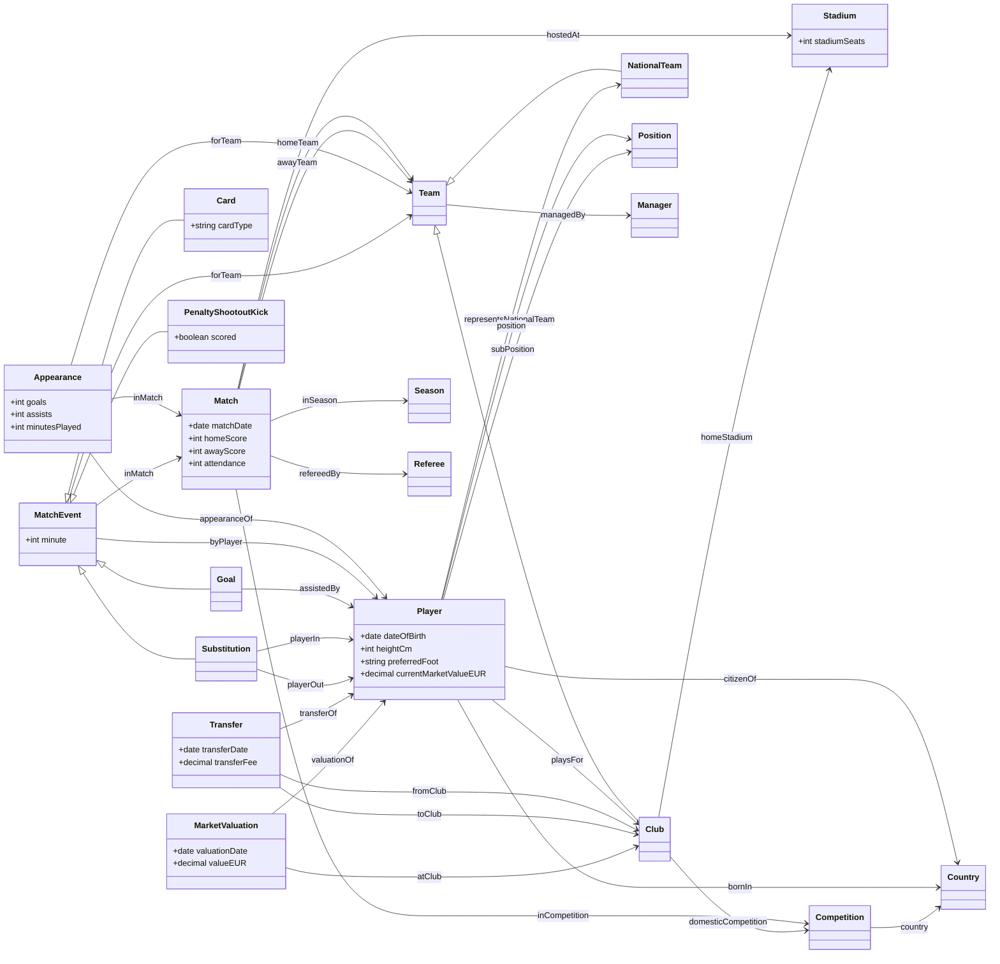

# Football Linked Open Data

Transfermarkt CSVs → football ontology → 4-star RDF → 5-star links (Wikidata, DBpedia, GeoNames) → Fuseki SPARQL endpoint.

## Quick start

```bash
python3 -m venv .venv && .venv/bin/pip install -r requirements.txt
make all            # tests, scope, build, vocabulary check, links, Fuseki load, checks
```

Requires Python 3.12, Docker and network access (the Fuseki image downloads Apache Jena; linking calls Wikidata).
The CSVs go in `datasets/` (git-ignored).

- Endpoint: <http://localhost:3030/football/sparql> (web UI at <http://localhost:3030/>)
- Terminal: `scripts/query.sh queries/q01_top_scorers_pl_2023.rq` (CSV by default; pass a MIME type as 2nd argument for other formats)

## Web application

The web app needs Fuseki running (`scripts/load.sh`, which starts only Fuseki). Run the web app **one** of two ways, both on <http://localhost:8000>:

- `make web`: runs it locally from the virtualenv (reads `FUSEKI_URL`, default `http://localhost:3030/football`);
- `docker compose up -d --build web`: runs it in a container (gunicorn; there `FUSEKI_URL` is `http://fuseki:3030/football`).

Do not start both at once, they use the same port.

| Route | What it does |
|---|---|
| `/` | search box, question box and the nine example queries |
| `/search?q=messi` | players, clubs, national teams, competitions and countries by name |
| `/page/<kind>/<id>` | entity page: properties, links to Wikidata/DBpedia/GeoNames, transfers, market values, squad |
| `/resource/<kind>/<id>` | Linked Data URI: `303` to the HTML page for browsers, to Turtle, JSON-LD, RDF/XML or N-Triples for clients that ask for them |
| `/ontology` | the ontology as HTML or RDF |
| `/query` | question box (plain English, e.g. “top scorers Premier League 2023”) and SPARQL playground (CodeMirror editor, example queries, CSV/JSON download) |

### Asking in plain English

The box on `/` and `/query` turns a question into SPARQL with rules and templates (no external service, no model). It shows the generated query and an **Open in editor** button, so the answer can be checked and refined.
Supported questions, each with optional competition (Premier League, La Liga, Serie A, Bundesliga, Ligue 1, Champions League, Europa League, World Cup), season (`2023`, `2022/23`) and `top N`:

| Ask | Example |
|---|---|
| top scorers / assists, optionally for a team | `top scorers Premier League 2023`, `top assists La Liga 2022`, `top scorers Real Madrid 2023` |
| a player's totals | `Haaland goals Premier League 2023` |
| transfers: most expensive, of a player, to/from a club | `most expensive transfers`, `Messi transfers`, `transfers to Arsenal` |
| squad or most valuable players | `Arsenal squad`, `players of Brazil`, `most valuable players` |
| market value history | `Messi market value` |
| biggest wins, matches, head to head | `biggest wins Champions League`, `results of Arsenal 2023`, `Arsenal vs Chelsea` |
| find a resource by name | `mbappe` (accents are ignored) |

Names are linked by searching the English labels in the endpoint (`Bayern Munich`, not `Bayern München`). A question it cannot parse gets the three nearest example questions. `POST /api/ask` with `{"question": "..."}` returns the same result as JSON.

```bash
curl -L -H "Accept: text/turtle" http://localhost:8000/resource/player/28003
```

### Namespace

Resources live under `https://vdhugn.github.io/Football-LOD/resource/` and the ontology under `https://vdhugn.github.io/Football-LOD/ontology#`. GitHub Pages only serves static files, so opening these URIs at github.io does not return data by itself. The app serves exactly the same paths, so the URIs resolve once the app is reachable under that namespace (own domain, w3id.org redirect or reverse proxy); locally `http://localhost:8000/resource/...` maps to the canonical URIs stored in the endpoint. The base URIs are set in `config.json`; changing them means rebuilding the data (`make build links load`).

## Scope

GB1, ES1, IT1, L1, FR1, CL and EL for seasons 2012–2025; FIWC (all six World Cups in the source). Edit `config.json` to narrow or widen it.
`game_lineups.csv` and `club_games.csv` are not used.

## Results of the last run

- Data: 14,180,422 triples (appearances 7.5M, events 3.1M, valuations 2.0M, transfers 0.6M, matches 0.48M, players 0.44M); Fuseki holds 14,232,449 triples including ontology and links.
- In scope: 30,132 games, 25,482 players, 10,671 clubs (791 of them described in `clubs.csv`, the rest are minimal nodes from transfer history), 135 national teams.
- Links (`output/links/report.json`):
  players 23,287 of 25,482 (91.4%), national teams 135 of 135, competitions 8 of 8,
  clubs listed in `clubs.csv` 753 of 791 (95.2%; 26.2% of all clubs because of the minimal nodes),
  countries 167 of 208 names (80.3%), stadiums 261 of 760 (`skos:closeMatch`).
  Only unambiguous one-to-one Transfermarkt-ID / Wikidata-item pairs become links; 24 clubs with ambiguous IDs are skipped (see `ambiguous` in `report.json`).
- Validation: ontology vocabulary check OK; SHACL on the full data `sh:conforms true`; all five dangling-reference checks return 0; 175 unit tests pass.
- Build is deterministic (two runs are byte-identical); relinking runs offline from `.cache/wikidata/` in under a second.

## Ontology

Simplified view of `ontology/football.ttl` (main classes, relations and a few attributes; the file has the full list with labels, domains and ranges).
Appearances, events, transfers and valuations are separate nodes because they relate more than two things (player, match, team, club).



## Layout

| Path | Purpose |
|---|---|
| `ontology/football.ttl` | ontology (English only) |
| `src/` | scope selection, builders, Wikidata linking, vocabulary check |
| `src/footballweb/` | Flask web app (entity pages, content negotiation, ontology page, SPARQL playground, plain-language questions in `ask.py`) |
| `shapes/football-shapes.ttl` | SHACL shapes |
| `queries/` | nine competency queries; `queries/checks/` has dangling-reference checks |
| `scripts/` | `load.sh` (load + start Fuseki), `query.sh`, `run_checks.sh`, `shacl.sh` |
| `docker/`, `docker-compose.yml` | Apache Jena Fuseki 5.5.0 with TDB2 |
| `docs/superpowers/` | design spec and implementation plan, including the decisions made while planning |

## Known limits of the source data

- World Cup appearances exist only for the 2026 edition; earlier editions have results and events only.
- `transfer_fee` empty and `0` cannot be told apart, so no fee triple is written unless the fee is positive. Future-dated transfers (contract ends) exist in the source.
- Many older players have no transfer history, so some transfer queries return few or no rows.
- Stadium links are lower precision than the other links and use `skos:closeMatch`.
- Managers are modelled as nodes keyed by name and are not linked externally.

## Not built

A statistics dashboard, authentication and rate limiting, and a public deployment of the web app (so the github.io URIs do not resolve on their own yet).
