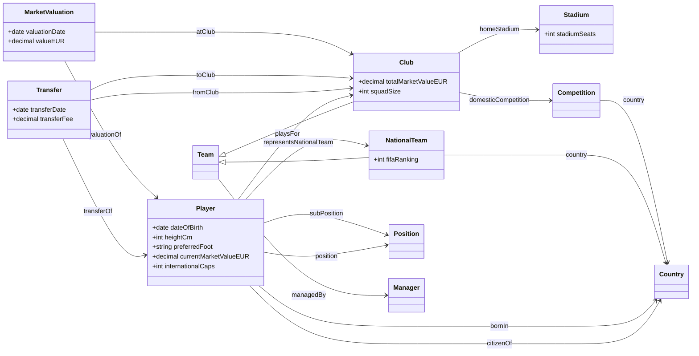

# Football Linked Open Data

Players, clubs, stadiums, national teams, transfers and market values of the top five European leagues (season 2025/26).

Transfermarkt CSVs → football ontology → 4-star RDF → 5-star links (Wikidata, DBpedia, GeoNames) → Fuseki SPARQL endpoint.

## Quick start

```bash
python3 -m venv .venv && .venv/bin/pip install -r requirements.txt
make all            # tests, scope, build, vocabulary check, links, Fuseki load, checks
```

Requires Python 3.12, Docker and network access (the Fuseki image downloads Apache Jena; linking calls Wikidata).
The CSVs go in `dataset/` (git-ignored).

- Endpoint: <http://localhost:3030/football/sparql> (web UI at <http://localhost:3030/>)
- Terminal: `scripts/query.sh queries/q01_most_valuable_players_by_league.rq` (CSV by default; pass a MIME type as 2nd argument for other formats)

## Web application

The web app needs Fuseki running (`scripts/load.sh`, which starts only Fuseki). Run the web app **one** of two ways, both on <http://localhost:8000>:

- `make web`: runs it locally from the virtualenv (reads `FUSEKI_URL`, default `http://localhost:3030/football`);
- `docker compose up -d --build web`: runs it in a container (gunicorn; there `FUSEKI_URL` is `http://fuseki:3030/football`).

Do not start both at once, they use the same port.

| Route | What it does |
|---|---|
| `/` | search box, question box and the nine example queries |
| `/search?q=haaland` | players, clubs, national teams, competitions and countries by name |
| `/page/<kind>/<id>` | entity page: properties, links to Wikidata/DBpedia/GeoNames, transfers, market values, squad |
| `/resource/<kind>/<id>` | Linked Data URI: `303` to the HTML page for browsers, to Turtle, JSON-LD, RDF/XML or N-Triples for clients that ask for them |
| `/ontology` | the ontology as HTML or RDF |
| `/query` | question box (plain English, e.g. “most valuable players Premier League”) and SPARQL playground (CodeMirror editor, example queries, CSV/JSON download) |

### Asking in plain English

The box on `/` and `/query` turns a question into SPARQL with rules and templates (no external service, no model). It shows the generated query and an **Open in editor** button, so the answer can be checked and refined.
Supported questions, each with optional league (Premier League, La Liga, Serie A, Bundesliga, Ligue 1), year (`2023`) and `top N`:

| Ask | Example |
|---|---|
| squad or most valuable players, optionally in a league | `Arsenal squad`, `players of Brazil`, `most valuable players Premier League` |
| transfers: most expensive, of a player, to/from a club, in a year | `most expensive transfers`, `Mbappe transfers`, `transfers to Arsenal`, `transfers from Real Madrid 2023` |
| market value history | `Haaland market value` |
| find a resource by name | `mbappe` (accents are ignored) |

There is no match data, so questions about goals, results or appearances are not understood.

Names are linked by searching the English labels in the endpoint (`Bayern Munich`, not `Bayern München`). A question it cannot parse gets the three nearest example questions. `POST /api/ask` with `{"question": "..."}` returns the same result as JSON.

```bash
curl -L -H "Accept: text/turtle" http://localhost:8000/resource/player/418560
```

### Namespace

Resources live under `https://vdhugn.github.io/Football-LOD/resource/` and the ontology under `https://vdhugn.github.io/Football-LOD/ontology#`. GitHub Pages only serves static files, so opening these URIs at github.io does not return data by itself. The app serves exactly the same paths, so the URIs resolve once the app is reachable under that namespace (own domain, w3id.org redirect or reverse proxy); locally `http://localhost:8000/resource/...` maps to the canonical URIs stored in the endpoint. The base URIs are set in `config.json`; changing them means rebuilding the data (`make build links load`).

## Scope

Set in `config.json` under `scope`:

- **Clubs**: rows of `clubs.csv` whose `domestic_competition_id` is GB1, ES1, IT1, L1 or FR1 and whose `last_season` is 2025 (the 96 clubs of the 2025/26 season).
- **Players**: rows of `players.csv` whose current club is one of those clubs and whose `last_season` is 2025.
- **Transfers and market valuations**: the full history of those players. Clubs met there are added as well, so every club reference resolves; clubs without a row in `clubs.csv` become minimal nodes with a name.

Tables used: `players`, `clubs`, `player_valuations`, `transfers`, `national_teams`, `countries`, `competitions`.
Not used: `games`, `appearances`, `game_events`, `game_lineups`, `club_games` (no match data).

## Results of the last run

- Data: 526,265 triples, 35 MB of Turtle (valuations 282k, transfers 156k, players 68k, clubs 17k, reference 3k).
- In scope: 3,464 players, 4,461 clubs (585 described in `clubs.csv`, 3,876 minimal nodes from transfer and valuation history), 563 stadiums, 22,996 transfers, 56,450 market valuations, 124 national teams, 171 countries.
- Validation: ontology vocabulary check OK; SHACL on the full data `sh:conforms true`; the four dangling-reference checks return 0; 162 unit tests pass.
- Links have not been rebuilt since the scope change: run `make links`.

## Ontology

Simplified view of `ontology/football.ttl` (main classes, relations and a few attributes; the file has the full list with labels, domains and ranges).
Transfers and valuations are separate nodes because they relate more than two things (player, clubs, date).



## Layout

| Path | Purpose |
|---|---|
| `ontology/football.ttl` | ontology (English only) |
| `src/` | scope selection, builders, Wikidata linking, vocabulary check |
| `src/footballweb/` | Flask web app (entity pages, content negotiation, ontology page, SPARQL playground, plain-language questions in `ask.py`) |
| `shapes/football-shapes.ttl` | SHACL shapes |
| `queries/` | nine competency queries; `queries/checks/` has dangling-reference checks |
| `scripts/` | `load.sh` (load + start Fuseki), `query.sh`, `run_checks.sh`, `shacl.sh` |
| `docker/`, `docker-compose.yml` | Apache Jena Fuseki 5.5.0 with TDB2 |
| `docs/superpowers/` | design spec and implementation plan, including the decisions made while planning |

## Known limits of the source data

- Few players have a current national team: 30 of the 3,464 players in scope have `current_national_team_id`, and 29 of those point to a team listed in `national_teams.csv`, so `fb:representsNationalTeam` is sparse. Citizenship (`fb:citizenOf`) is present for every player.
- Stadiums only have a name and a seat count; more (location, opening year) has to come from the Wikidata links.
- `transfer_fee` empty and `0` cannot be told apart, so no fee triple is written unless the fee is positive. Future-dated transfers (contract ends) exist in the source.
- `COL1` (Colombian league) is used by clubs but missing from `competitions.csv`; it becomes a minimal competition node.
- Stadium links are lower precision than the other links and use `skos:closeMatch`.
- Managers are modelled as nodes keyed by name and are not linked externally.

## Not built

A statistics dashboard, authentication and rate limiting, and a public deployment of the web app (so the github.io URIs do not resolve on their own yet).
